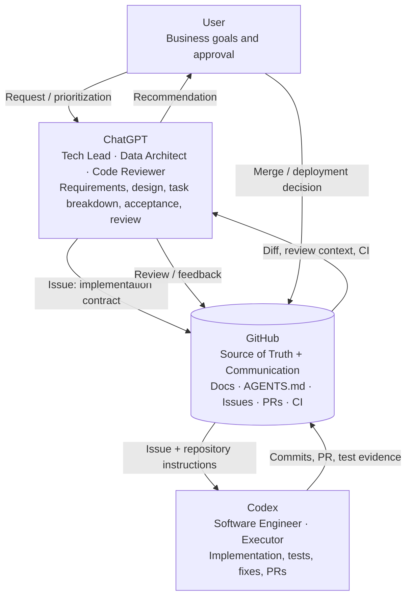
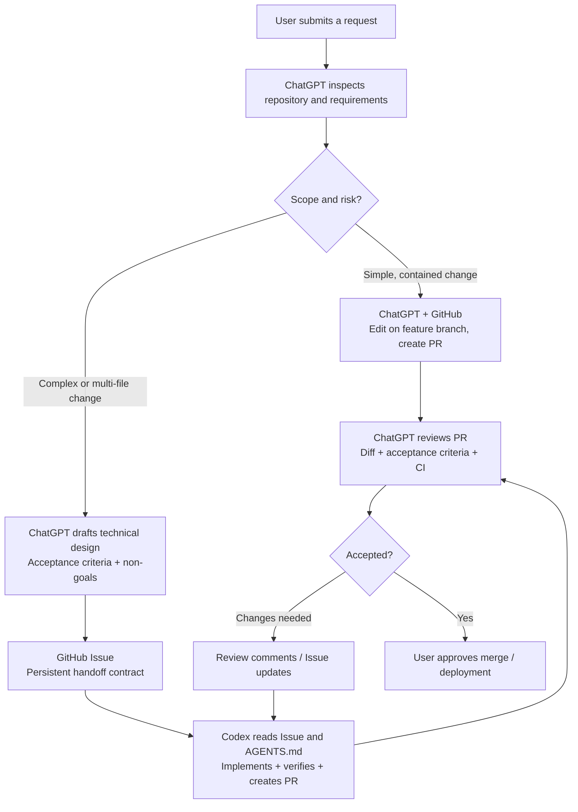
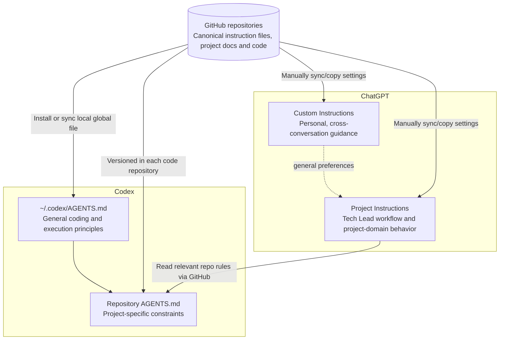

# ChatGPT with Codex — Development Collaboration Framework

A **ChatGPT-led development workflow** that separates technical leadership from code execution. GitHub acts as the **source of truth and communication channel**, not as a decision-making agent.

> Status: **Architecture scaffold / draft templates**. Instructions in this repository are starting points; they are **not automatically synchronized** to ChatGPT settings or local Codex configuration.

## 1. Roles and responsibilities



**Decision boundary:** ChatGPT proposes design and reviews delivery; Codex executes within the agreed scope, validates against real code, and flags blockers rather than silently changing architecture. The user controls final merge and deployment.

## 2. Standard development workflow



For small requests, a GitHub Issue is optional; a PR still provides an auditable record. For complex requests, write the design **before** handing execution to Codex.

## 3. Layered instructions architecture



**Separation of concerns:**

| Location | Owns | Does not own |
| --- | --- | --- |
| ChatGPT global Custom Instructions | Personal preferences, high-level communication style | Repository-specific schemas and test commands |
| ChatGPT Project Instructions | Tech Lead / Data Architect / Reviewer workflow | One-off implementation tasks |
| Codex global `~/.codex/AGENTS.md` | General engineering practices and verification habits | Specific business metric definitions |
| Per-project `AGENTS.md` | Actual project boundaries, authoritative docs, tests | Duplicated universal philosophy |
| GitHub Issue | A single task's design, constraints and acceptance criteria | Permanent project policy |
| GitHub PR | Implementation, test evidence, review discussion | Unreviewed production authorization |

Project-level rules in GitHub must stay with their **own code repository**. This configuration repository stores a reusable template, not a second copy of every project's rules.

## 4. Repository layout

```text
ChatGPT-with-Codex-skill/
├── README.md
├── chatgpt/
│   ├── global.md
│   └── projects/
│       └── data-development.md
├── codex/
│   └── AGENTS.md
├── templates/
│   ├── repository-AGENTS.md
│   ├── development-issue.md
│   └── pr-review.md
└── docs/
    ├── architecture.md
    └── workflow.md
```

## 5. How to use

1. Review the instructions in `chatgpt/global.md` and `chatgpt/projects/data-development.md`, then paste them into their corresponding ChatGPT settings. They **do not auto-sync**.
2. Review `codex/AGENTS.md` and install it as `~/.codex/AGENTS.md` on your Mac. Its contents should not replace a repository's own `AGENTS.md`.
3. For each coding repository, adapt `templates/repository-AGENTS.md` into that repository's `AGENTS.md`.
4. For substantial changes, create an Issue using `templates/development-issue.md`. Codex reads the Issue, implements it on a branch, tests, and opens a PR.
5. ChatGPT reviews the PR using `templates/pr-review.md`. The user decides whether to merge or deploy.

See [Architecture](docs/architecture.md) and [Workflow](docs/workflow.md) for details.

## 6. Working principles

- **ChatGPT leads the design; Codex executes the specification.**
- **GitHub retains decisions and evidence** through Issues, PRs, docs and code.
- **Instructions describe durable policy; Issues describe individual tasks.**
- **Verification is evidence-based:** never claim tests ran if they did not.
- **Cost optimization is a goal, not permission to skip safety or correctness.**
