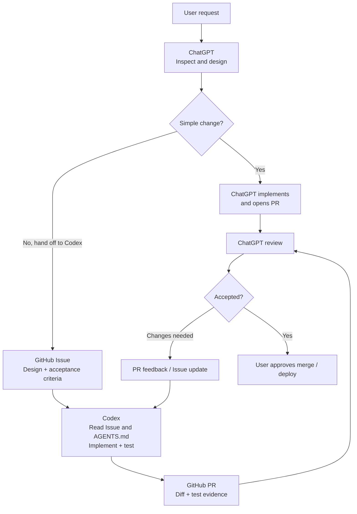

# ChatGPT with Codex

**ChatGPT designs. Codex builds. GitHub connects them.**

A modular instruction kit for a **ChatGPT-led development workflow**. ChatGPT handles technical leadership and review; Codex focuses on implementation; GitHub stores persistent instructions, Issues, PRs, and review evidence.

## Roles and architecture

| Actor | Responsibility |
| --- | --- |
| **ChatGPT** | **Tech Lead · Data Architect · Code Reviewer** — analyze, design, split tasks, define acceptance criteria, review delivery. |
| **Codex** | **Implementation Engineer** — follow scoped instructions, change code, test, open/update PRs. |
| **GitHub** | **Source of truth and communication channel** — version instructions and code; connect agents using Issues and PRs. |
| **User** | Set goals, resolve key decisions, approve merge and deployment. |

## Development workflow



The [Issue-to-PR module](templates/github-issue-to-pr.md) enables this handoff in a ChatGPT Project. **It is not automated:** ChatGPT creates the Issue in the application repository, the user starts Codex with that Issue, and ChatGPT reviews the resulting PR.

## Instruction layers

| Layer | Location | Purpose |
| --- | --- | --- |
| ChatGPT global | [`chatgpt/global.md`](chatgpt/global.md) | Cross-conversation engineering principles |
| ChatGPT Project | [`chatgpt/projects/data-development.md`](chatgpt/projects/data-development.md) | Tech Lead / Architect / Reviewer responsibilities |
| **Optional ChatGPT modules** | [`templates/`](templates/) | Paste one or more independent workflow modules into Project Settings when needed |
| Codex global | [`codex/AGENTS.md`](codex/AGENTS.md) | General implementation and verification rules |
| Codex project references | [`codex/projects/`](codex/projects/) | Flat `<project-name>.md` copies of application `AGENTS.md` files |

Each **application repository's own `AGENTS.md`** remains the rule file Codex loads in that project. Files under `codex/projects/` are centrally stored reference copies, **not automatically loaded or synchronized**. A reusable [repository AGENTS.md starter](codex/repository-AGENTS-template.md) is also available.

## Repository structure

```text
ChatGPT-with-Codex-skill/
├── README.md
├── chatgpt/
│   ├── global.md
│   └── projects/
│       └── data-development.md
├── codex/
│   ├── AGENTS.md
│   ├── repository-AGENTS-template.md
│   └── projects/
│       └── trading-stats.md
└── templates/
    ├── github-issue-to-pr.md
    ├── development-issue.md
    └── pr-review.md
```

**Using the kit:** Copy `chatgpt/global.md` to ChatGPT Custom Instructions; paste a base Project instruction file and any desired `templates/*.md` modules together into ChatGPT Project Settings; install `codex/AGENTS.md` locally as `~/.codex/AGENTS.md`. None of these settings auto-sync from GitHub. Changes to project-rule copies must also be reconciled with their application's actual `AGENTS.md`.

Instructions define long-lived behavior; **GitHub Issues define individual tasks** and **PRs carry implementation and review evidence**.
