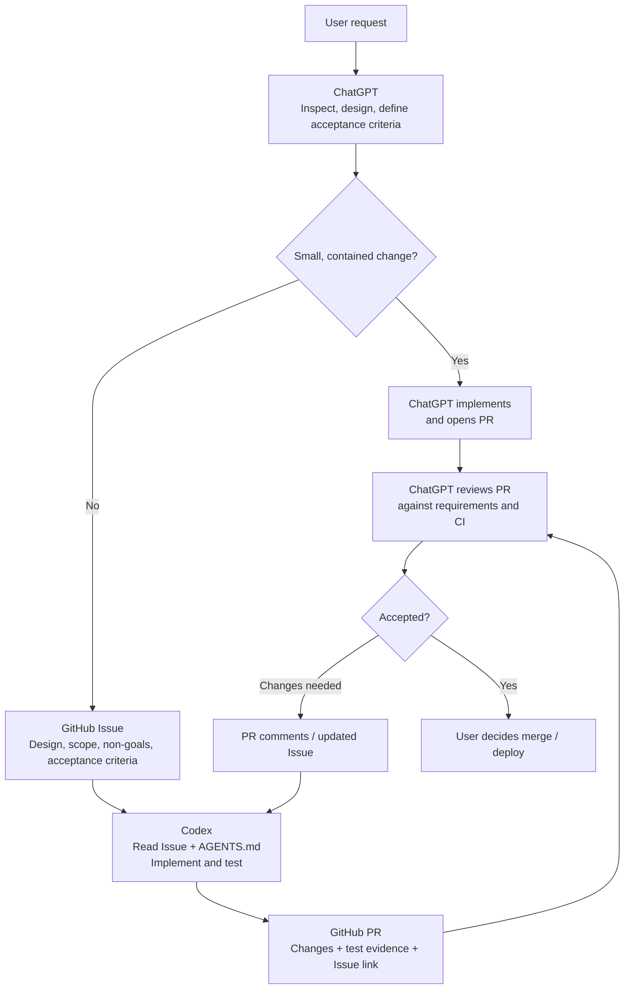

# ChatGPT with Codex

**ChatGPT designs. Codex builds. GitHub connects them.**

A reusable, GitHub-centered development workflow for software and data engineering. ChatGPT handles the thinking-intensive work so Codex can execute well-scoped tasks efficiently. This repository is an **instruction and workflow kit**, not an autonomous agent or executable skill.

## Responsibilities

| Actor | Responsibility |
| --- | --- |
| **ChatGPT** | **Tech Lead · Data Architect · Code Reviewer** — understand requirements, inspect repositories, design solutions, split tasks, define acceptance criteria, and review PRs. |
| **Codex** | **Implementation Engineer** — follow the Issue and `AGENTS.md`, implement changes, run tests, resolve review feedback, and open PRs. |
| **GitHub** | **Source of truth and communication channel** — store instructions, code, Issues, PRs, and CI evidence. |
| **User** | Define goals, resolve key decisions, and approve merges or deployments. |

## Workflow



### GitHub is the handoff protocol

1. **ChatGPT → GitHub Issue:** ChatGPT writes a concrete implementation contract using the [development Issue template](templates/development-issue.md).
2. **Issue → Codex:** Codex reads the Issue and target repository's `AGENTS.md`, implements on a branch, validates the acceptance criteria, and creates a PR linked to the Issue.
3. **PR → ChatGPT:** ChatGPT reviews the actual diff and test evidence using the [PR review checklist](templates/pr-review.md). Feedback goes into PR comments; material scope changes go back into the Issue.
4. **Approval:** The user owns the final merge and deployment decision.

Example instruction to Codex once an Issue exists:

```text
Implement issue #42 in owner/repo.
Read the Issue and repository AGENTS.md.
Stay within scope, run relevant tests, and open a PR linked to the Issue.
```

**Important:** This is a documented workflow, not automatic agent-to-agent messaging. ChatGPT must create the Issue, and Codex needs authenticated GitHub access and an explicit task to read it.

## Instruction layers

| Scope | Reference file | Applied in |
| --- | --- | --- |
| ChatGPT global principles | [`chatgpt/global.md`](chatgpt/global.md) | ChatGPT Custom Instructions |
| ChatGPT development role and handoff | [`chatgpt/projects/data-development.md`](chatgpt/projects/data-development.md) | ChatGPT Project Instructions |
| Codex global engineering rules | [`codex/AGENTS.md`](codex/AGENTS.md) | Local `~/.codex/AGENTS.md` |
| Application-specific rules | [`templates/repository-AGENTS.md`](templates/repository-AGENTS.md) | `AGENTS.md` in each application repository |

Global configuration is maintained here; **each application repository owns its actual project `AGENTS.md` and business definitions**. Copy or sync the relevant settings explicitly—GitHub edits do not automatically update ChatGPT or local Codex.

For implementation details, see [Architecture](docs/architecture.md) and [Development Workflow](docs/workflow.md).
